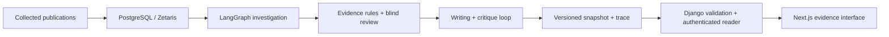

# Quorum

**Evidence-first news investigation, with a trace a reader can inspect.**

Quorum groups coverage of one event, separates statements from corroborated
claims, and presents the evidence, disagreements and framing behind a daily
brief. It was built by a three-person team for the Open Agent Hackathon 2026.

**Current status:** source and reproducible offline examples are available. The
former hosted demo is retired; there is no live-service promise. The local demo
uses fictional stories and deterministic model stand-ins, not current news or
proof that an external provider is connected.

## Review the engineering

1. [Run the offline reviewer path](docs/REVIEWER_GUIDE.md): a synthetic reasoning
   run, its trace, tests, and an optional local browser preview.
2. Inspect the [sample snapshot](docs/examples/snapshot.sample.json) and
   [reasoning graph](reasoning/quorum_reasoning/graph.py): claims, evidence and
   trace are explicit data, not only generated prose.
3. Follow the [portal acceptance boundary](backend/portal/reasoning_preview.py)
   and [immutable edition reader](backend/portal/reasoning_editions.py).
4. Read [architecture and tradeoffs](docs/ARCHITECTURE.md), the canonical
   [decisions](docs/DECISIONS.md), and [integration contract](docs/PORTAL_INTEGRATION.md).

## System shape

The offline path substitutes fixture input and deterministic model responses for
the collection/provider layers. It exercises the graph and output contract without
claiming independent verification of real-world facts.

- **Evidence discipline:** independent source groups, quotation checks and
  unresolved disagreements retained as disputed or unconfirmed.
- **Controlled iteration:** bounded research/critique loops, explicit partial
  output and an auditable model-call ledger for configured live runs.
- **Publication boundary:** authenticated readers, immutable edition files,
  hash-bound metadata, separate development previews and publishing gates.
- **Readable product:** articles first; sources, framing and reasoning available
  when the reader wants to inspect them.

## Team and attribution

| Contributor | Recorded responsibility |
| --- | --- |
| [Vadim / @rcc00n](https://github.com/rcc00n) | Web/platform ownership: Django portal, authentication/control, acceptance and delivery boundaries |
| [Anastasia / @AnastasiaShkirpan](https://github.com/AnastasiaShkirpan) | Collection and catalog; portal UX and later shared integration work |
| [Yelysei / @Sor1na](https://github.com/Sor1na) | Reasoning architecture, investigation graph and edition generation |

These are team responsibilities, not exclusive claims to every line of code.
Commits, pull requests and [Issue #2](https://github.com/rcc00n/Quorum/issues/2)
retain the detailed handoffs. [AGENTS.md](AGENTS.md) defines the collaboration and
decision-recording rules.

## Development and verification

Python 3.11+ for the combined reasoning/backend environment; Node 22 for the web.
The existing [CI](.github/workflows/portal.yml) covers Django, reasoning, fixture
contracts, TypeScript/build and isolated browser boundaries. It does not deploy.

[Reviewer setup](docs/REVIEWER_GUIDE.md) is the shortest entry point.
Module details: [backend](backend/README.md), [web](web/README.md),
[reasoning](reasoning/README.md), [collection](collectors/README.md).

## Limits and historical evidence

Source tests and synthetic examples do not establish live inference, publication
quality, source availability or sponsor integration today. Historical releases and
measured runs are dated records, not current operational guarantees. Real edition
inputs, credentials and private runtime output are intentionally not distributed.

The former long README is preserved in the [hackathon archive](docs/history/hackathon-2026.md).
Product decisions and collaborator attribution remain intact; this review pass
changes documentation and reproducibility, not the investigation algorithm.
The web dependency is pinned to Next.js 16.4.6 after the previous patch triggered
the upstream build advisory; deployment remains a separate operation.

## Decisions

2026-11-25 · rcc00n / Codex · Make the root README a current, attributed source
review guide; archive the dated hackathon narrative and offer the existing
synthetic offline path. Why: a retired demo must not be advertised as live, and
local test evidence must remain distinct from provider integration.

2026-11-25 · rcc00n / Codex · Pin Next.js 16.4.6 after the previous locked patch
failed the upstream security build check. Why: the documented local reviewer
build must complete without bypassing the advisory; no deployment or UI change.
