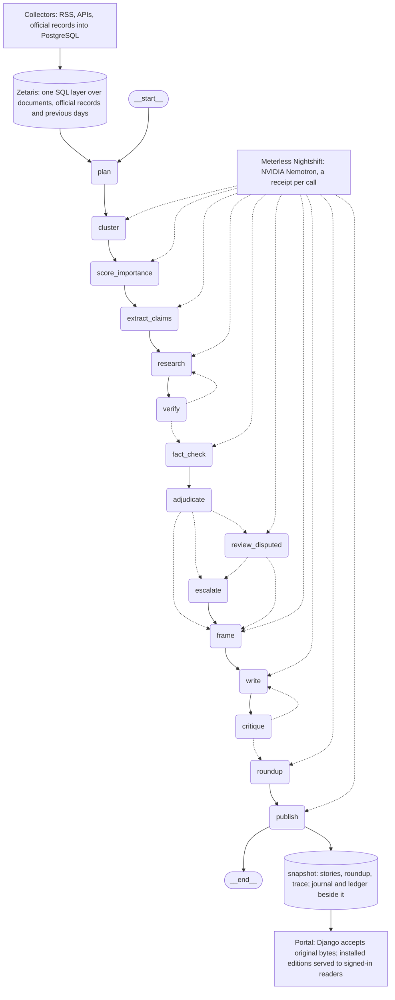

# Quorum — AI-powered news intelligence & fact verification

> **Track:** 03 Reasoning Architecture · **User:** a reader who wants the day's events on their topics with the evidence under every line · **Sponsor technology:** Zetaris (data), Meterless Nightshift (model runtime), NVIDIA Nemotron (models) · **Run:** [Run it](#run-it) · **Samples:** [Samples](#samples-inputs-and-outputs) · **Logs:** [Logs and traces](#logs-and-traces)

**Shared release tracker: [GitHub Issue #2](https://github.com/rcc00n/Quorum/issues/2). All developers and coding assistants must follow [AGENTS.md — Shared Project Tracking and Cross-Agent Handoff](AGENTS.md#shared-project-tracking-and-cross-agent-handoff).**

Quorum is a multi-agent system that takes one news event, gathers coverage from sources across the political spectrum and official government documents, separates what is actually known from what is claimed, verifies statements against evidence, and shows how each part of the spectrum frames the same event. It does not ask the user to trust its answer: every substantive conclusion links to the sources it rests on.

Built by team **Quorum** for the [Open Agent Hackathon 2026](https://hackathon.genai.works/event/open-agent-hackathon-2026), Track 03 — **Reasoning Architecture**. Build window 22–27 October 2026; submissions close 27 October 2026, 23:45 UTC.

**Live site:** https://quorum.raccncode.com/ — the landing is public; the reader behind it needs a login.

**Live authenticated demo:** https://quorum.raccncode.com/dashboard?date=2026-10-26 —
the genuine provisional immigration edition (1 story, 19 roundup entries, 174 trace steps).
Sign in with the privately supplied judge account, or register under the existing open-registration flow.
[Exact production release, browser/CI evidence and remaining limits](deploy/LIVE_RELEASE.md).

## What it does

- **Multi-source intelligence** — RSS, news APIs and official publications, federated through Zetaris so agents query everything as one SQL layer; publications are grouped by event.
- **Autonomous fact verification** — agents extract checkable claims, look for supporting and contradicting evidence, request more sources when needed, and separate confirmed facts from disputed and unverifiable ones. Reprints of a single wire story count as one piece of evidence, not ten.
- **Evidence-based reasoning** — every conclusion carries its sources and reasoning trace; when evidence is thin, the system says so instead of guessing. An independent fact-checker agent re-verifies claims without seeing the primary verifier's output.
- **Stories as articles** — each story is a short article built only from verified claims: facts with their sources, the parties' statements with their authors, and what is not confirmed, in a fixed order and with no evaluation added. Signed documents are facts; statements are statements. The reader forms their own view.
- **An impact bar, not a top ten** — up to ten stories a day per topic, shown only if they cross an absolute bar (legal force, reach, irreversibility, at least one independent source). No minimum: a quiet day says so. Everything below the bar goes into an "Also today" roundup, one line per event with its source.
- **Narrative & framing comparison** — as an appendix to each story: what left and right outlets highlight, omit and how they word it, by cohort (major/minor × left/right) under four selectable bias-rating modes (AllSides, MBFC, Ad Fontes, averaged).
- **A simple reader** — topics chosen by the user, one card per topic in the manner of Apple News, text instead of metrics; coverage, silence, evidence and reasoning traces one link away.

The full set of decisions — scope, principles, source list, cohort rules, UI, stack, demo plan, open questions — is in [docs/DECISIONS.md](docs/DECISIONS.md). That file is the source of truth; code that contradicts it is a bug.

## Agents

One LangGraph graph per topic and day (`reasoning/quorum_reasoning/graph.py`); every node reads and writes the same run state (claims, events, evidence, drafts, trace rows) and appends its trace row. Roles, from `docs/ARCHITECTURE.md` § 5:

| Node | Responsibility | Model? | Can block, loop or retry |
| --- | --- | --- | --- |
| `plan` | Loads the day's corpus through Zetaris and gives every event the same research budget (which sources failed today is not computed yet; `sources_missing` stays empty) | no | — |
| `cluster` | Groups the day's documents into events by structured keys (actors, action, object, place, date) | yes | — |
| `score_importance` | Reports the legal status and the state of the act; code maps them to rubric points; `above_bar` by code | yes (facts), code (points) | Its rubric decides the bar gate |
| `extract_claims` | Atomic claims with their origin quote and offsets, from fetched text (access level 1) or leads (level 2) | yes | — |
| `research` | Evidence per claim: round 1 the event's own documents, round 2 the rest of the day's corpus, official documents and previous days, all through Zetaris | yes | Loops: `verify` sends thin claims back (2 rounds max) |
| `verify` | The confirmation rule: independent source groups behind a claim | no (rule) | Sends back |
| `fact_check` | A blind second check with its own evidence; sees nothing from `research` or `verify` | yes | Independent authority; skipped with no call for an event whose rubric cannot reach the bar |
| `adjudicate` | The final status; disputed when the two checks disagree; confirmation points per event | no | Routes disputes to `review_disputed`, flags to `escalate` |
| `review_disputed` | A third blind pass on claims the two checks disagree on, with both evidence chains as data | yes | One call per claim, never repeated |
| `escalate` | A flagged story leaves the stories and goes to the roundup as `needs_review` | no | Blocks a story |
| `frame` | Per outlet: what it highlighted, omitted and how it worded the story | yes (labels) | — |
| `write` | The article from confirmed claims, statements with their speaker, open items; rewrites on critique | yes | Loops with `critique` |
| `critique` | The writing rules; rejects a draft with each violation and the offending text | no (rules) | Blocks: up to 3 drafts; a story still rejected at the third is published with the critic's notes, flagged `needs_review`, with any unconfirmed fact block demoted to "not confirmed" |
| `roundup` | One line per event below the bar, with source and status | yes (line text) | — |
| `publish` | The immutable snapshot (stories, roundup, trace), version +1, the topic summary | yes (summary) | — |

## What makes this an agent system

- **Blind independence.** The fact-checker re-verifies every claim without seeing the researcher's or the verifier's output; when the two disagree, a third blind reviewer decides from both evidence chains, and an unresolved disagreement stays `disputed` in print.
- **Critique loop.** The critic rejects a draft with the rule and the offending text; the writer fixes only that; a story still rejected after three drafts is published with the critic's notes, flagged `needs_review`, and any fact block whose claims are not all confirmed is demoted to "not confirmed", never silently.
- **Dynamic delegation.** Research round 2 runs only for claims that are still thin, and widens to the rest of the day's corpus, the official documents and the previous days.
- **Role authority.** The bar gate denies the expensive blind check to events that cannot become a story; `escalate` removes a flagged story from print; `critique` can hold a draft.
- **Shared state.** Every node reads and writes one run state (`reasoning/quorum_reasoning/state.py`) and leaves a trace row; nothing is passed by prompt alone.
- **Retry and resume.** One explicit retry per model call on 429/5xx/timeouts, honouring `Retry-After` (the SDK's own retries are off, so every attempt is in the ledger); a run that dies mid-way continues with `--resume` from its last completed node, replaying its own journal so no paid call repeats.
- **Honest failure.** A node that fails after its retry leaves a public error row; the edition is published as `partial`, never patched; a day with no event above the bar is a quiet day, said in so many words.

## Architecture

The graph as LangGraph draws it from the code (`python -m quorum_reasoning.run --mermaid`; dotted edges are the conditional ones), with the data layer, the model runtime and the portal added around it:



The loops: `verify → research` (at most 2 research rounds, round 2 only for thin claims), `critique → write` (at most 3 drafts), `adjudicate → review_disputed` (one third-reviewer call per claim the two checks disagree on; a claim both call disputed is not reviewed); the node contract and the limits in `docs/ARCHITECTURE.md` § 5. `langgraph dev` opens the same graph in LangGraph Studio.

## How the sponsor technologies are used

**Zetaris, the data layer.** The collectors write every publication and official record into PostgreSQL (`collectors/schema.sql`). That database is registered in the official Zetaris platform as the datasource `QUORUM_COLLECT` (`collectors/zetaris/register.py`, `collectors/zetaris/01_register_postgres.sql`), and everything downstream reads it only through Zetaris' Lightning SQL REST API (`agent/tools_zetaris.py`): the reasoning graph pulls an edition's corpus with `--corpus zetaris` (`reasoning/quorum_reasoning/nodes/plan.py` via `tools/corpus.py`), and `collectors/zetaris/evidence.py` runs the same two corpus queries without their text columns and writes a sanitised evidence file. Committed evidence: [`collectors/zetaris/evidence/russia-ukraine-war_2026-10-24.json`](collectors/zetaris/evidence/russia-ukraine-war_2026-10-24.json), a real query over the 2026-10-24 window (86 rows from 17 sources plus one official release; counts; titles cut to 80 characters; no text, no credentials), reconciled against reasoning's own `plan` row on a second machine in [Issue #2, 24 Oct](https://github.com/rcc00n/Quorum/issues/2#issuecomment-6386233676). Zetaris runs on team members' machines, never on the public website.

**Meterless Nightshift, the AI provider.**

- *Route.* Every model call of the reasoning graph goes through one OpenAI-compatible route read from `.env` (`MODEL_BASE_URL`, `MODEL_API_KEY`, `NEMOTRON_MODEL`, or the `METERLESS_*` names; `.env.example`). With Nightshift that route is the local runtime (Nightshift 1.2.3, `http://127.0.0.1:8088/v1`), its Runtime token and the two headers Nightshift expects, `meterless-app` and `meterless-scope` (`smoke_test.py`, `reasoning/quorum_reasoning/llm.py`). `python -m quorum_reasoning.run --test-connection` is the preflight; NVIDIA's direct endpoint is the documented development alternative.
- *Models.* Two Nemotron models serve the graph's task lanes: Nemotron 3.5 Lightning on the worker lane, Nemotron 3 Ultra on the blind fact-checker and reviewer lanes (`reasoning/README.md` › Run it). The run ledger records for every call the model that answered and, on the Nightshift route, the receipt id and how many memories the runtime injected (`llm.py` ledger row: `served`, `receipt_id`, `receipt_hmem_injected`); a pinned lane answered by another model is an error row. Each receipt id is meant for Nightshift's Console › Proof (`reasoning/README.md` › Run it). As of 26 October no receipt has been looked up in the Console; Vadim validated the Ed25519 proof signatures of the 180 receipts in one local Nightshift journal under the runtime's supplied public key, which is not an independent NVIDIA or billing attestation ([Issue #2, 24 Oct](https://github.com/rcc00n/Quorum/issues/2#issuecomment-6379478959)).
- *Evidence.* Five diagnostic completions, one per Nightshift route, each with a receipt id: the one on the explicit Ultra id was answered by Ultra, the four `meterless/*` dispositions by Lightning ([Issue #2, 23 Oct](https://github.com/rcc00n/Quorum/issues/2#issuecomment-6376996285); no graph run). Reported in Issue #2 (counts only, the run files are private): a labelled showcase edition, `climate-policy` for 2026-10-26, through Nightshift from the PR #29 branch, 202 of 202 ledger rows carrying a receipt, 0 injected memories on every row after the guard set `hmemKnowledge` false before the first call ([Issue #2, 26 Oct](https://github.com/rcc00n/Quorum/issues/2#issuecomment-6423850385)). A second Nightshift run, the H-MEM live check of 26 October from the branch `yelysei/meterless-engine` with the engine on (3 records written, none recalled yet), made 188 calls with 0 failed ([hand-over](https://github.com/rcc00n/Quorum/issues/2#issuecomment-6428877713)). The canonical editions of 26 October ran on NVIDIA's direct endpoint with the same code and models ([counts](https://github.com/rcc00n/Quorum/issues/2#issuecomment-6418787032)).
- *Status (26 October).* The guard that keeps Nightshift's source memory out of independent verification is in the open PR #29 (`yelysei/agents` → `integration`, not merged). The Meterless Engine feature (an H-MEM source memory: `frame` writes framing labels and confirmed evidence, research round 2 recalls them as candidates only, off by default) is on the branch `yelysei/meterless-engine`, also unmerged.

**NVIDIA Nemotron** is the model family on both routes; the dry run (`--dry-run`) replaces every model call with a deterministic stand-in and spends no credits.

## Run it

One path through the whole system, in the order the data flows: collect, reason, serve, install. Each step is documented in its module; the commands below are the ones those READMEs give, copied here so a reviewer can go from a clone to a running portal without reading them first. The collector and the reasoning block read the repo-level `.env` (`.env.example` lists every name); the portal takes its switches as exported environment variables (`backend/README.md`).

**0. Prerequisites.** Docker Desktop (PostgreSQL, the collector and the official Zetaris platform run in containers), Python 3.12 or newer, Node 22 or newer, and a model route: the Meterless Nightshift runtime on the same machine (the primary route) or an NVIDIA API key (the development alternative). Copy the template and fill in the Zetaris settings and the model route; the file is git-ignored and never committed.

```bash
git clone https://github.com/rcc00n/Quorum.git && cd Quorum
cp .env.example .env        # fill ZETARIS_* and the model route (METERLESS_TOKEN, or MODEL_BASE_URL + MODEL_API_KEY)
```

**1. Collect** (`collectors/README.md`). Starts PostgreSQL and the collector, which makes one pass over every topic in the `topics` table and then pauses for 15 minutes. With the official Zetaris platform running, the second command registers that database in Zetaris as the datasource `QUORUM_COLLECT`; run it again after a schema change, because Zetaris caches column lists.

```bash
docker compose -f collectors/docker-compose.yml up -d --build
python3 collectors/zetaris/register.py
docker compose -f collectors/docker-compose.yml logs -f collector     # watch a pass
```

**2. Reason** (`reasoning/README.md`). The graph runs from `reasoning/` in its own virtual environment. A dry run spends no credits: the fixture corpus and deterministic stand-ins for every model call. `--models` lists the routes the configured runtime offers and sends no completion; `--test-connection` sends one small completion per lane and prints the answering model and its receipt. A live edition reads the day's documents through Zetaris and writes the next immutable `v<N>.json` under `--out`, with a journal, a ledger and per-node checkpoints beside it.

```bash
cd reasoning
python -m venv .venv && . .venv/bin/activate          # Windows: .venv\Scripts\activate
pip install -e ".[dev]"
python -m pytest                                      # rules + end-to-end dry run, no credits

python -m quorum_reasoning.run --topic russia-ukraine-war --date 2026-10-22 --dry-run      # no credits
python -m quorum_reasoning.run --models                                                    # free
python -m quorum_reasoning.run --test-connection                                           # 2 paid calls
python -m quorum_reasoning.run --topic <topic> --date <YYYY-MM-DD> --model live --corpus zetaris --out snapshots/_private
python -m quorum_reasoning.run --topic <topic> --date <YYYY-MM-DD> --model live --corpus zetaris --out snapshots/_private --resume   # continue a run that died
```

A whole day of editions for several topics goes through the edition runner: without `--live` it only runs the dry checks and prints the call estimates; with `--live` it runs the topics one after another, writes one log per run and one status file per topic, and on `--route meterless` stops a topic at its first error instead of patching around it (`docs/reviews/2026-10-27-demo-runbook.md`). `--hmem on` switches the H-MEM source memory on and needs `METERLESS_HOME` and `QUORUM_HMEM_DIR` exported.

```bash
python -X utf8 scripts/run_editions.py --date <YYYY-MM-DD> --topics immigration-southern-border,russia-ukraine-war --route meterless --out snapshots/_private --log-dir snapshots/_runs/logs --status-dir snapshots/_runs/status --dry-check-out snapshots/_runs/dry
python -X utf8 scripts/run_editions.py --date <YYYY-MM-DD> --topics immigration-southern-border,russia-ukraine-war --route meterless --hmem on --out snapshots/_private --log-dir snapshots/_runs/logs --status-dir snapshots/_runs/status --dry-check-out snapshots/_runs/dry --live
```

Every published edition gets a sidecar and two sha256 files for the hand-over to the portal; the hand-over set is the snapshot, the sidecar, both hashes and the producer commit, never the ledger or the journal.

```bash
python -X utf8 scripts/edition_sidecar.py --snapshot snapshots/_private/<topic>/<date>/v<N>.json --corpus-as-of <YYYY-MM-DDTHH:MMZ> --producer-commit $(git rev-parse HEAD)
```

**3. Serve** (`backend/README.md`, `web/README.md`). Django on `127.0.0.1:8017` first, then the Next.js portal on `127.0.0.1:3017`, which rewrites `/api/`, `/staff/` and `/staff-static/` to Django. `deploy/build-web.sh` builds the web app outside the repository.

```bash
python3 -m venv ~/.local/share/quorum/portal-venv
~/.local/share/quorum/portal-venv/bin/pip install -r backend/requirements.txt
export DJANGO_DEBUG=1
~/.local/share/quorum/portal-venv/bin/python backend/manage.py migrate
~/.local/share/quorum/portal-venv/bin/python backend/manage.py createsuperuser
~/.local/share/quorum/portal-venv/bin/python backend/manage.py runserver 127.0.0.1:8017
```

```bash
bash deploy/build-web.sh
cd ~/.local/share/quorum/portal-web-build
npm run dev -- --hostname 127.0.0.1 --port 3017       # then open http://127.0.0.1:3017
```

**4. Check and install an edition** (`backend/README.md` › Control and checks, `docs/PORTAL_INTEGRATION.md`). The acceptance command checks a reasoning 1.0 snapshot read-only: both sha256 values against the bytes, the sidecar's binding to the snapshot, the producer commit (resolved with `git show` in the portal's own checkout, so fetch first) and the hash of `reasoning/config/reasoning.toml` at that commit, and that the output is genuine model output. `--install` copies cleanly accepted bytes into the login-only reader's directory, `QUORUM_REASONING_EDITIONS_ROOT`; a checkout without `.git` (a release tarball) passes `--producer-config` with that commit's `reasoning.toml` instead.

```bash
git fetch origin
export QUORUM_REASONING_EDITIONS_ROOT=~/.local/share/quorum/editions && mkdir -p "$QUORUM_REASONING_EDITIONS_ROOT"
~/.local/share/quorum/portal-venv/bin/python backend/manage.py reasoning_snapshot --file v1.json --sha256 <sha256 of v1.json> --sidecar v1.json.sidecar.json --sidecar-sha256 <sha256 of the sidecar> --producer-commit <40-hex commit>             # check only
~/.local/share/quorum/portal-venv/bin/python backend/manage.py reasoning_snapshot --file v1.json --sha256 <sha256 of v1.json> --sidecar v1.json.sidecar.json --sidecar-sha256 <sha256 of the sidecar> --producer-commit <40-hex commit> --install   # check, then install
```

Signed-in readers then see the edition on the board for its date, with its `provisional`, `corpus as of` and `requires editorial review` labels. The development-only preview renders a snapshot file without installing it (`QUORUM_ENABLE_REASONING_PREVIEW=1`, `QUORUM_REASONING_PREVIEW_FILE=<snapshot>`, `DJANGO_DEBUG=1`, route `/preview/reasoning`). The portal's own proposal store is a separate path: `portal_snapshot validate --file <candidate.json>`, then `portal_snapshot prepare` and `portal_snapshot publish --file $QUORUM_SNAPSHOT_ROOT/staging/<file> --sha256 <sha256>` behind the `QUORUM_ENABLE_SNAPSHOT_PUBLICATION` flag (`docs/SNAPSHOT_PROPOSAL.md`).

## Samples: inputs and outputs

| # | Input | Output | Content |
| --- | --- | --- | --- |
| 1 | The bundled fixture corpus of a normal day (`reasoning/quorum_reasoning/fixtures/sample_day.json`) | [`docs/examples/snapshot.sample.json`](docs/examples/snapshot.sample.json): two stories above the bar, two roundup items, one verifier/fact-checker disagreement resolved by the third blind reviewer, 47 trace rows | fictional, real shape |
| 2 | The quiet-day fixture (`--fixture usecases/quiet_day`) | [`docs/examples/snapshot.empty-day.sample.json`](docs/examples/snapshot.empty-day.sample.json): `status: empty`, no stories, every event in the roundup, 27 trace rows | fictional, real shape |
| 3 | The normal-day fixture of row 1 with every outlet-framing (`frame`) model call made to fail | [`docs/examples/snapshot.partial.sample.json`](docs/examples/snapshot.partial.sample.json): `status: partial`, the failed node and the two affected events named in `errors`, stories without framing labels | fictional, real shape |
| 4 | The collected corpus of 2026-10-24 for `russia-ukraine-war`, queried through Zetaris | [`collectors/zetaris/evidence/russia-ukraine-war_2026-10-24.json`](collectors/zetaris/evidence/russia-ukraine-war_2026-10-24.json): counts by source and type and a sanitised sample (no text, titles cut to 80 characters) | real |
| 5 | The post-cut corpus of 2026-10-26 (six topics in the dump, [comment](https://github.com/rcc00n/Quorum/issues/2#issuecomment-6414086161)), restored into Zetaris ([comment](https://github.com/rcc00n/Quorum/issues/2#issuecomment-6414901529)) | Five editions run over it, counts per edition in [Issue #2](https://github.com/rcc00n/Quorum/issues/2#issuecomment-6418787032): one story above the bar (immigration), four quiet days; the files are private | real, private |

The fictional three are rebuilt with `python scripts/regenerate_samples.py` from `reasoning/` (`docs/examples/README.md`; last regenerated in `c0c3071`, 25 October); every file carries `provenance.fictional: true` and the portal labels such data as demo.

## Logs and traces

- **Trace in every edition.** A snapshot carries `trace`: one row per node execution with the node, iteration, event, decision, reason, model and duration, plus an optional `detail` (`reasoning/quorum_reasoning/trace.py`); `memory` rows appear only when the H-MEM engine is switched on, which is decided for the 27 October runs but not in the merged code yet. The fictional sample has 47 rows; the development-only reasoning preview (`/preview/reasoning`, `web/components/reasoning-timeline.tsx`) renders it as an Investigation Timeline per story. The public site shows no reasoning trace yet.
- **Journal, ledger, checkpoints.** A live run writes a journal of every request with its full payload (and, through Nightshift, its receipt) to `<out>/_journal/<run_id>.jsonl`, the ledger beside the snapshot as `v<N>.ledger.json` (task, lane, route, answering model, HTTP status, finish reason, tokens, attempts, receipt id, error) and per-node checkpoints in `<out>/_checkpoints/<run_id>.sqlite` (always on for a live run; `--checkpoint` turns them on for a dry run) (`reasoning/quorum_reasoning/run.py`, `llm.py`); `--verbose` prints each model call as it happens, `--resume` continues a live run from its last completed node. A dry run writes no journal.
- **Real runs.** Their files stay outside the public repository (`AGENTS.md` § 3): the journal holds full request payloads with article passages, the snapshots raw error diagnostics and verbatim quotes. Per edition the counts are posted in Issue #2: five editions of 26 October on NVIDIA's direct route, 0 failed calls ([comment](https://github.com/rcc00n/Quorum/issues/2#issuecomment-6418787032)); the Nightshift showcase with receipts ([comment](https://github.com/rcc00n/Quorum/issues/2#issuecomment-6423850385)).
- **Collector and data layer.** `docker compose -f collectors/docker-compose.yml logs -f collector`; sanitised Zetaris query evidence files via `collectors/zetaris/evidence.py` (written to `collectors/zetaris/evidence/<topic>_<date>.json`).

## Failure handling

| Failure | Behaviour |
| --- | --- |
| A model call returns 429, 5xx or times out | One explicit retry honouring `Retry-After` (`reasoning/quorum_reasoning/llm.py`); then the node records a public error, the run goes on and the snapshot is `partial` with the gap named in `errors`; on the paced NVIDIA-direct route a second call refused on 429 within ten minutes stops the run instead (exit 3, no snapshot), continued later with `--resume`; Nightshift never aborts |
| A run dies mid-way | `python -m quorum_reasoning.run … --resume` continues from the last completed node and replays the run's own journal, so no paid call is repeated |
| The Nightshift route misbehaves (4xx or 5xx, a lane answered by another model, an injected memory, a Traceback) | The runner's Meterless stop rule (`reasoning/scripts/run_editions.py` on `yelysei/agents`, PR #29, not merged) kills that run at its first such error, marks the topic `failed`, leaves the topics after it queued and prints the manual NVIDIA-direct fallback command without running it; a rerun resumes the stopped run only if its journal holds no call the rule rejects and nothing was published, otherwise the topic runs again as a fresh attempt |
| A source forbids the crawler or is paywalled | Access level 2: headline and lead only, disclosed per quote in the reasoning preview; level 3: the fact of coverage only, no claims from it |
| Zetaris is unreachable | The run fails before any model call and no edition is produced |
| A claim rests on one source group | `verify` sends it to research round 2; still single-sourced, it is not confirmed |
| The two blind checks disagree | `review_disputed` decides; otherwise the claim stays `disputed` |
| A draft breaks a writing rule | `critique` rejects it with the offending text; after three drafts the story is published with the notes attached |
| A story is flagged | `escalate` moves it to the roundup as `needs_review`; the development preview marks it "Needs review" (the public site shows no reasoning output yet) |
| No event crosses the bar | A quiet day: `status: empty`, every event in the roundup, the brief says so |
| Fictional or demo data | Labelled: `provenance.fictional: true`, the DEMO banner on every page that shows it (a reader may close it for the browser session since 2026-10-27; it returns on the next visit; see docs/DECISIONS.md › User account and interface, item 12) |

## Data and licensing

- Collected publications keep URL, title, lead, source, times, access level and a content hash; **no article text is stored** (`collectors/README.md`). Reasoning fetches text at analysis time through `collectors.common.fetch_text`, which honours robots.txt and the source's access level, and stores only the quotes it cites, with character offsets.
- Official records (Federal Register, Congress.gov, White House releases) are public documents and are stored in full.
- No photo tool is built: `photo` is null in every edition. The rule for when it comes (US federal sites and openly licensed Wikimedia Commons only, with credit and caption) is in `docs/DECISIONS.md` › Stories as articles.
- The three files in `docs/examples/` are fictional (`provenance.fictional: true`). Real editions are not in the repository; their counts are posted in Issue #2, and Yelysei's hand-over plans to publish each installed edition with its public trace under `docs/examples/editions/<date>/` (planned, not recorded as a decision yet). Ledgers and journals stay private.

## Limitations

- Forty sources in English: US outlets plus three European agencies and papers; no social networks.
- Paywalled outlets and sites that forbid the crawler count by headline and lead only.
- One edition per topic per day, run by the team after the 05:30 New York cut and installed by an operator; the site itself starts nothing. Topics come from the team's catalog; the site cannot add one.
- Positions on the spectrum come from AllSides, MBFC and Ad Fontes, not from us.
- A quiet day has no story; the first real day (24 October) had none above the bar of 6. Yelysei lowered the bar to 4 on 26 October for the 27 October runs; the change is merged through PR #29. Historical editions keep their recorded threshold.
- Live runs need the operators' machines: the Nightshift runtime on Windows, Zetaris with the collected corpus, the model credits; real editions reach the public site behind the deployed login-only reader (PR #31); each new edition still requires acceptance and operator installation.

## Submission

- **Event:** Open Agent Hackathon 2026, Track 03 Reasoning Architecture; team Quorum: Vadim (@rcc00n), Anastasia (@AnastasiaShkirpan), Yelysei (@Sor1na). Submissions close 27 October 2026, 23:45 UTC.
- **Repository:** this one, with this README and the module READMEs. It starts on the evening of 21 October (UTC−5; 00:37 UTC on 22 October) with eight commits of environment scripts and docs (`15fe52b` and following); the product code was written in the build window of 22–27 October.
- **Pre-existing components:** none of our own. `smoke_test.py` is adapted from the organisers' participant setup guide; the environment scripts of 21 October predate the window by a few hours (previous bullet). Every agent, adapter and page was written in the build window; the dependencies are listed in `reasoning/pyproject.toml`, `backend/requirements.txt`, `collectors/requirements.txt` and `web/package.json`.
- **Demo video and slides:** the organisers require a 1–4 minute video with audio that shows Meterless doing work ([Issue #2](https://github.com/rcc00n/Quorum/issues/2#issuecomment-6393551309)), plus slides. As of 26 October only a silent 3:42 captioned draft and a seven-slide PDF exist, both private ([Issue #2](https://github.com/rcc00n/Quorum/issues/2#issuecomment-6390833160), [26 Oct](https://github.com/rcc00n/Quorum/issues/2#issuecomment-6428420842)); the final video and slides are linked here once they exist.
- **Live portal:** https://quorum.raccncode.com (the landing is public; the reader behind it needs a login). It serves `20261027-live-r3`, source `63418421c1c0909dc0d7dfa1b451da3eed1bcc76`, with the accepted genuine provisional 26-Oct immigration edition and a privately supplied ordinary judge login. Exact CI/browser/restart/rollback evidence and limits: [release report](deploy/LIVE_RELEASE.md).
- **Sponsor use:** the section above; the rules and organiser updates in `docs/RULES_CHECK.md`.

## Web Integration: Start Here

[Web handoff and owner notifications](docs/TEAM_HANDOFF.md) → [current adapter/contract](docs/PORTAL_INTEGRATION.md) → [reproducible tests](docs/PORTAL_VERIFICATION.md#current-reproducible-checks). The development preview remains local-only; production serves the accepted genuine edition through the opt-in authenticated reader. The separate proposal publisher remains disabled.

## Stack

| Layer | Technology |
| --- | --- |
| Data | [Zetaris](https://www.zetaris.com/) — one SQL layer over all sources |
| Reasoning | NVIDIA Nemotron (3.5 Lightning, 3 Ultra) through Meterless Nightshift as the primary provider; NVIDIA's direct endpoint is the documented development alternative (`.env.example`) |
| Reasoning orchestration | Python + LangGraph, LangGraph Studio for development and the demo; design in [docs/ARCHITECTURE.md](docs/ARCHITECTURE.md), code in [`reasoning/`](reasoning/README.md) |
| Web | Next.js + TypeScript frontend; Django auth, API and Quorum Control |
| Development | Vadim uses Codex; team members use their own assistants (Codex, Claude Code); shared rules in [AGENTS.md](AGENTS.md), organizer-update evidence in [docs/RULES_CHECK.md](docs/RULES_CHECK.md); one branch per member, `master` through pull requests |

## Repository layout

| Path | What it is |
| --- | --- |
| `docs/PORTAL_INTEGRATION.md` | Canonical collector/reasoning/portal handoff and proposed interfaces |
| `docs/RULES_CHECK.md` | Official Track 03/sponsor evidence and human-reported Cursor update |
| `docs/DECISIONS.md` | Product and architecture decisions, with a change log at the end |
| `docs/ARCHITECTURE.md` | Reasoning block: the LangGraph graph, rules, analysis schema, snapshot contract for the portal, build plan |
| `docs/SETUP.md`, `docs/SPONSOR_SETUP.md`, `docs/MANUAL_ACTIONS.md` | Local environment: WSL2, Docker, the official Zetaris platform bundle, remaining manual steps |
| `docs/examples/` | Three dry-run reasoning snapshots (fictional content, real shape) with their regenerate commands; see [Samples](#samples-inputs-and-outputs) |
| `reasoning/` | The reasoning block: LangGraph graph, rules, prompts, dry-run fixture, tests; `reasoning/README.md` says how to run it |
| `agent/tools_zetaris.py` | Read-only Lightning SQL against the local Zetaris REST API |
| `smoke_test.py` | Checks the Data (Zetaris) and Power (Nemotron via Meterless/NVIDIA) layers from the participant setup guide |
| `scripts/` | `doctor.sh`, `verify-all.sh`, service helpers, security check |
| `reports/` | Dated environment readiness records |
| `AGENTS.md`, `CLAUDE.md` | Rules for AI coding assistants; `CLAUDE.md` only points to `AGENTS.md` |
| `.env.example` | Variable names only. Copy to `.env` (git-ignored) with your own values |

## Working agreements

Vadim uses Codex; other team members use their own assistants (including Claude Code); the shared rules are tool-independent. To keep choices visible across tools, [AGENTS.md](AGENTS.md) requires every non-trivial decision to be recorded where it applies: project-wide ones in `docs/DECISIONS.md`, module-level ones in that folder's `README.md`, file-level ones as a `DECISION(...)` comment at the spot — in the same commit as the code, and never overriding someone else's decision silently. If a task contradicts `docs/DECISIONS.md`, change the decision first, then the code.

## Environment

Ubuntu-20.04 is confirmed as **WSL2**. Use the existing Linux Docker CLI and backend. Dependencies, the official Zetaris platform bundle, private deployment and credentials live outside version control. The deployment uses only the bundle's six required default services (including two one-shot jobs); The chosen Nemotron/Meterless route uses privately configured credentials; placeholders do not establish access.

```bash
./scripts/doctor.sh       # tools, WSL2, Docker, GitHub; no Cursor acceptance gate
./scripts/verify-all.sh   # doctor + memory/state tests + Zetaris checks; NO provider inference
# Optional: --inference explicitly sends one capped request with real sponsor credentials
```

Exit codes: `0` all checks passed, `1` at least one failure, `2` blocked or untested checks remain. Output uses `PASS`, `FAIL`, `BLOCKED`, `NOT_TESTED`. Missing sponsor credentials intentionally produce `BLOCKED`. Cursor checks are historical opt-in (`python3 scripts/checks.py cursor-history`) and never affect routine summaries. Cursor is optional under the official event rule 5.1, independently checked on 2026-10-25 UTC ([Issue #2](https://github.com/rcc00n/Quorum/issues/2#issuecomment-6390833160) and the tracker's checked item); Zetaris and Meterless remain required. `docs/RULES_CHECK.md` keeps the earlier human-reported state for the record.

Start with [setup](docs/SETUP.md), [sponsor configuration](docs/SPONSOR_SETUP.md), [manual actions](docs/MANUAL_ACTIONS.md) and the historical environment [readiness record](reports/readiness.md). The official Zetaris platform runs on team members' own machines, each with the collectors' database registered as `QUORUM_COLLECT`: Anastasia's, where the collectors run and the committed evidence was queried, and Yelysei's, where each dump is restored and re-registered and the editions run over it ([Issue #2, 24 Oct](https://github.com/rcc00n/Quorum/issues/2#issuecomment-6386233676), [26 Oct](https://github.com/rcc00n/Quorum/issues/2#issuecomment-6414901529)).

Environment readiness alone does not satisfy the hackathon's submission requirements: a 1–4 minute demo video, slides, this repository with a README, and an explanation of how the sponsor technologies were used (verify the current list on the challenge page in HackOS).

## Web portals

The Next.js user portal and Django **Quorum Control** are isolated in `web/` and `backend/`. Canonical handoff: [PORTAL_INTEGRATION.md](docs/PORTAL_INTEGRATION.md). Setup: [frontend](web/README.md), [backend](backend/README.md). VPS deployment and rollback: [deploy](deploy/README.md). Editions produced by the reasoning block are not published on the site yet (the no-website-publication rule in `docs/DECISIONS.md` › Still to clarify, and the `QUORUM_ENABLE_SNAPSHOT_PUBLICATION` flag); the planned judges' reader behind a login is tracked in [Issue #2](https://github.com/rcc00n/Quorum/issues/2).
