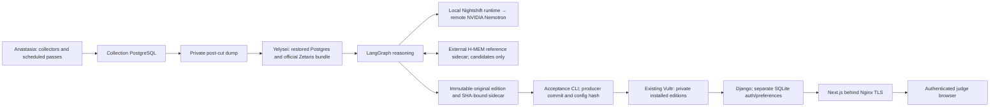

# Hosting assessment — 26 October 2026 (client date)

Verified at 2026-10-27 00:50–01:00 UTC. Owner: rcc00n / Codex.
Canonical deployment separation: docs/DECISIONS.md › Stack and work blocks.

**Selected: retain the existing Vultr VPS for the portal and retain the proven
collection/processing machines. Additional server cost: $0/month.** The existing
Vultr invoice and provider/NVIDIA usage charges are unavailable here, so the total
existing account bill cannot be asserted. No purchase was made.

## Actual architecture

The processing locations and 27-Oct run schedule are owner-confirmed in Issue #2
6430394441/6430558228; this session has not remotely audited their machines. The
26-Oct genuine query/run receipts remain attributable to their original owners.
Local bundled Zetaris SELECT 1/sample query/official verify.sh succeeded separately.

The portal host was independently inspected over owner SSH: DMI vendor Vultr,
x86_64, 3905 MiB RAM, about 380 MiB available at first check, 70 GiB root filesystem
with 40 GiB free. Both Quorum services were active, with loopback ports and
192/256 MiB memory caps. Many unrelated workloads share the host; preserve them.
Builds run locally. No collection/Postgres/Zetaris/model runtime is needed on the
portal host. Its SQLite auth database was about 7 MiB including private runtime data.

The supplied official platform bundle explicitly documents local Docker Compose,
registry authentication, preflight/verify scripts, 8 GiB and 4 CPUs. Thus this is
a supplied self-hosted hackathon bundle, not evidence of a managed sponsor endpoint.
[Zetaris describes on-premises/cloud deployment](https://www.zetaris.com/hubfs/Zetaris_Azure_One_Pager.pdf),
but that does not establish license permission for a new perpetual public-hosted
installation. Current bundle entitlement and team deployments are preserved;
no third-party-host migration or public Zetaris exposure is proposed.

## Official pricing comparison

The comparable portal class is Linux x86_64, at least 2 vCPU / 4 GiB and 40 GiB SSD,
one public IPv4, low traffic. Larger storage is shown explicitly. Prices are public
list estimates before applicable taxes, not checkout quotes; currencies stay separate.

| Option | CPU / RAM / disk | IPv4, transfer and backup | Estimated monthly total / availability |
| --- | --- | --- | --- |
| Existing Vultr + team processing | Existing portal caps; no new processing load | Existing TLS, IPv4 and private application backups | **$0 incremental**; existing bill unknown; already accessible |
| Hetzner CX23, EU | 2 Intel/AMD vCPU / 4 GB / 40 GB NVMe | €0.50 IPv4; 20 TB EU traffic; backups 20% of server price | €5.49 + €0.50 + €1.10 = **€7.09**; official page currently says unavailable |
| OVH VPS-1 | 2 vCore / 4 GB / 40 GB NVMe | IPv4 and daily previous-day backup included; unlimited traffic, 500 Mbps outside APAC quota exception | **From $4.54**; final region/term checkout must confirm price |
| Lightsail Linux public-IPv4 bundle | 2 vCPU / 4 GB / 80 GB SSD | IPv4 included; 4 TB transfer; snapshots $0.05/GB-month | **$24**, or **$28** budgeting 80 GB of stored snapshots; no free-tier assumption |
| EC2 t3.medium, illustrative us-east-1 | 2 x86 vCPU / 4 GiB / 80 GB gp3 | IPv4 $0.005/hour; storage extra; 100 GB account-wide internet-out allowance | 730 × $0.0416 + $6.40 disk + $3.65 IPv4 = **$40.42 before backups/egress/CPU credits**; about $44.42 with an 80-GB snapshot budget |
| New Vultr Cloud Compute | Candidate class 2 vCPU / 4 GB / at least 40 GB | Automatic backups add 20%; region/transfer allocation requires quote | **Price not verified**: two official product/pricing fetches returned 403. Existing VPS is verified, not its billing plan |
| netcup VPS 500 G12.5 | 2 x86 vCore / 4 GB / 64 GB SSD | Traffic and snapshots listed; independent off-host backup still needed | Public page lists **from €8.26/month**, 12-month commitment; final VAT/IPv4/region quote unverified, not selected |

Sources: [Hetzner current price notice](https://docs.hetzner.com/general/infrastructure-and-availability/price-adjustment/),
[availability/traffic](https://www.hetzner.com/cloud/cost-optimized/),
[IPv4](https://docs.hetzner.com/cloud/servers/primary-ips/overview/),
[backup billing](https://docs.hetzner.com/cloud/billing/faq/);
[OVH configurations, IPv4 and backups](https://www.ovhcloud.com/en/vps/);
[Lightsail bundles](https://aws.amazon.com/lightsail/pricing/),
[snapshot billing](https://docs.aws.amazon.com/lightsail/latest/userguide/amazon-lightsail-faq-snapshots.html);
[EC2 instance reference](https://github.com/aws/amazon-ec2-instance-selector),
[gp3](https://aws.amazon.com/ebs/pricing/),
[IPv4](https://aws.amazon.com/vpc/pricing/),
[transfer](https://aws.amazon.com/ec2/pricing/on-demand/);
[Vultr backup pricing](https://docs.vultr.com/product-overviews/backups);
[netcup current plans](https://www.netcup.com/en/server/vps).

If an independent processing server becomes necessary, 4 GiB is insufficient for
the supplied bundle. OVH VPS-2 advertises 4 vCore / 8 GB / 75 GB from $8.50;
Lightsail 8 GB / 160 GB is $44 plus snapshots. Even 8 GB needs a measured preflight
with Postgres/other processes and confirmation of sponsor entitlement. Do not buy
or migrate one merely to serve immutable editions. No purchase is currently proposed.

## Operational comparison and security

All candidates require an appropriate full Linux VM for Docker/PostgreSQL, explicit
persistent storage and backups. Preserve x86_64 images; ARM offerings need image
and wheel verification. EU Hetzner/OVH and globally offered AWS/Vultr/netcup locations
have different latency, stock and account-verification constraints. A new provider
can take minutes to provision but hours to verify DNS, TLS, restore, auth and billing;
these are estimates, not tested setup durations. AWS EC2 also adds separate network,
storage and burst-credit budgeting. Lightsail is simpler if AWS is eventually needed.

The existing host has demonstrated access and working TLS; new hosts have no measured
Quorum uptime or restore evidence. Vendor SLA is not an application availability test.
Keep processing credentials off the VPS, Postgres private, SSH key-only, API/Next on
loopback and auth backups restricted. Do not alter unrelated containers or services.
App-level SQLite backups and immutable releases remain necessary even with provider
snapshots. Capacity and rollback checks must pass again at the actual cutover.
