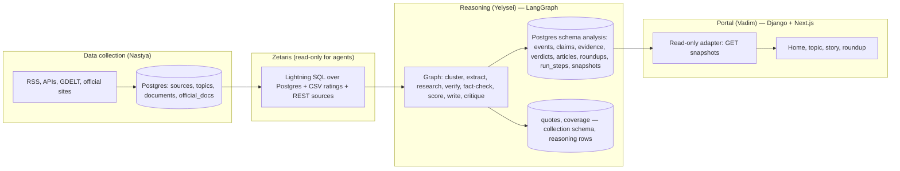
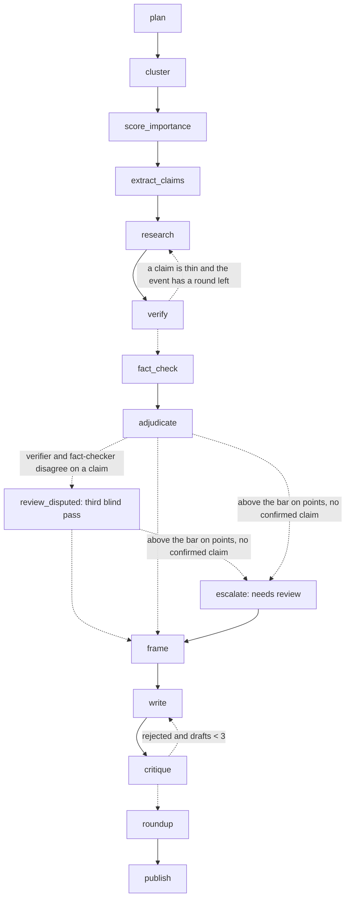

# Quorum — reasoning architecture

Owner: analysis and reasoning (Yelysei). First version 2026-10-22. Product decisions this document implements are in [DECISIONS.md](DECISIONS.md); the data contract it reads is [collectors/README.md](../collectors/README.md) and [collectors/schema.sql](../collectors/schema.sql) on `data-collection`; the portal it feeds is described in [PORTAL_INTEGRATION.md](PORTAL_INTEGRATION.md) on `feature/web-portals`. When this document and DECISIONS.md disagree, DECISIONS.md wins and this one is fixed.

## 1. In one paragraph

The reasoning block is a LangGraph graph in Python. Once a day per topic (and on demand for the demo) it reads the day's documents through Zetaris, groups them into events, extracts checkable claims, hunts for evidence, verifies each claim by fixed rules, lets an independent fact-checker re-verify blind, scores each event against the impact bar, writes a short article for every story above the bar and a roundup for everything below it, has a critic reject anything that breaks the writing rules, and publishes one snapshot per topic and day for the portal. Every step writes a trace row. Code computes; agents judge.

## 2. What is code and what is an agent

| Code (deterministic, SQL or Python) | Agent (an LLM call inside a graph node) |
| --- | --- |
| Confirmation rule: signed document, or two independent `independence_group`s | Whether a passage supports, contradicts or is neutral to a claim |
| Spread (every publication) vs confirmation (independent groups only) | Grouping publications into one event when text similarity is borderline |
| Impact-bar score from rubric points; the threshold; the cap of ten | The rubric facts: the legal status and the state of the act (code maps them to the legal-force and irreversibility points) and the reach points, which stay judged; a one-line rationale each |
| Cohort shares under the selected rating mode; coverage and silence | Extracting atomic checkable claims from a text |
| Ordering of the article (facts chronological, then statements, then not confirmed) | Writing the article and the roundup lines |
| Adjudication: two verdicts agree → final; disagree → a third blind pass, whose answer code validates (one of the two verdicts or disputed; decisive quote found; `confirmed` only when the cited chain passes the confirmation rule) | Critique of a draft against the writing rules; the third reviewer's choice between two evidence chains |
| Loop limits, retries, idempotent writes | Labeling how an outlet frames a story (highlights, omits, wording) |

Rule of thumb: if a judge could ask "why this number?", it is code. If the answer is "it read the text", it is an agent, and its output is stored with the input it saw.

## 3. Layers and data flow



- Agents read only through Zetaris. One SQL query joins documents, the source registry with ratings and an official-document feed; this is the sponsor technology doing real work, not a wrapper.
- Agents write nothing into the collection schema: for the hackathon the snapshot is the sole cross-block contract (DECISIONS.md log 2026-10-24, agreed by all three owners); `quotes` and `coverage` rows and the `analysis` schema of section 4 are superseded by the file store (`reasoning/store.py`) until after the hackathon. Zetaris is read-only for us.
- Article text is never stored. Reasoning calls the collection block's `collectors.common.fetch_text(url, title=, lead=)` at analysis time, which honours robots.txt and the source's access level, and stores only verbatim quotes with code-point offsets, the content hash of the text at fetch time and the achieved access level (section 8, evidence rows). Official documents are read in full from `official_docs`. The SQL also carries `canonical_url`, `content_hash` and `fetched_at` per document so a quote's hash can be compared with the collected one.
- The portal never reads `analysis` tables directly. It pulls published snapshots (section 8). Nothing from reasoning runs on the portal VPS.

## 4. Storage owned by reasoning

Schema `analysis` in the shared Postgres. All timestamps UTC. All ids stable across reruns of the same day (section 6).

| Table | Key columns | Notes |
| --- | --- | --- |
| `runs` | `id`, `topic_id`, `edition_date`, `started_at`, `finished_at`, `status`, `graph_version`, `config_json` | One row per graph run. `status`: running, ok, partial, failed. |
| `run_steps` | `id`, `run_id`, `node`, `iteration`, `event_id`, `input_ref`, `output_ref`, `decision`, `reason`, `model`, `tokens_in`, `tokens_out`, `duration_ms`, `created_at` | The trace. One row per node execution. Loops show as the same `node` with `iteration` 2, 3. |
| `events` | `id`, `run_id`, `topic_id`, `edition_date`, `headline`, `standfirst`, `rubric_json`, `rubric_total`, `confirmation_level`, `above_bar`, `rank`, `cluster_version` | `id` = `sha1(topic_id, edition_date, sorted document ids)[:12]`, so a rerun of the same day keeps the same id when the cluster is the same. |
| `event_documents` | `event_id`, `document_id`, `similarity`, `merged_by` | `merged_by`: code or model. |
| `claims` | `id`, `event_id`, `text`, `origin_document_id`, `origin_quote_id`, `kind` | `kind`: fact, statement, number. `id` = `sha1(event_id, normalized text)[:12]`. |
| `evidence` | `id`, `claim_id`, `quote_id`, `stance`, `found_by`, `independence_group`, `is_document` | `stance`: supports, contradicts, neutral, statement. `found_by`: researcher, verifier, fact_checker. |
| `verdicts` | `claim_id`, `verifier_status`, `verifier_reason`, `fact_checker_status`, `fact_checker_reason`, `final_status`, `adjudication` | `final_status`: confirmed, disputed, unverified. |
| `framings` | `event_id`, `source_id`, `highlights`, `omits`, `wording`, `example_document_id`, `interpretation_label` | One row per outlet that covered the event. |
| `articles` | `event_id`, `version`, `body_json`, `photo_json`, `reading_minutes`, `critic_status`, `critic_notes` | `body_json` is the block list of section 8. Versions kept: the critic's rejections are evidence for the demo. |
| `roundups` | `topic_id`, `edition_date`, `body_json`, `empty_day` | One per topic and day. |
| `snapshots` | `topic_id`, `edition_date`, `version`, `json`, `published_at` | What the portal pulls. Immutable per version. **Built 2026-10-24 as a file store** (`reasoning/store.py`: `snapshots/<topic>/<date>/v<N>.json`, `latest.json`, the run's private ledger beside it); the Postgres table and the rest of this schema stay DEFERRED for the hackathon (section 10). |

*Superseded 2026-10-24 (DECISIONS.md log): reasoning writes no `quotes` or `coverage` rows for the hackathon; the verbatim-quote rule lives on in the snapshot's evidence rows (offsets, `content_hash_at_quote`) and in `collectors.common.verify_quote`.* `quotes` and `coverage` live in the collection schema; reasoning inserts rows and never alters their schema. A `quotes` insert is rejected by collection if the quote is not found verbatim at the URL; reasoning treats a rejection as "no evidence", never as an error to retry around.

## 5. The graph

One `StateGraph` per topic run. Nodes are plain Python functions that return partial state; the LLM calls live inside them. Loops are conditional edges back into the graph. Every node appends its trace row (`steps`) before returning. Code: `reasoning/quorum_reasoning/graph.py`; the edges below are what `python -m quorum_reasoning.run --mermaid` draws from it (labels added by hand).



`review_disputed` sits between `adjudicate` and `frame` and runs only when at least one claim is disputed because the two blind checks disagreed (a claim both call disputed is a real contradiction and is not reviewed); it re-applies the bar and the cap afterwards, since a resolved claim changes an event's confirmed count, and then routes to `escalate` or `frame` exactly as `adjudicate` would. `escalate` continues to `frame` rather than jumping to `roundup` because one run covers every event of the day: the escalated event is dropped from the stories (it is no longer `above_bar`, so `frame` and `write` skip it) while the others go on; `roundup` then carries it as "reported, not confirmed" with the review flag.

### State

```python
class RunState(TypedDict):                      # reasoning/quorum_reasoning/state.py
    run_id: str
    topic_id: str
    edition_date: str            # YYYY-MM-DD, America/New_York edition day
    dry_run: bool                # deterministic stand-ins instead of model calls
    documents: list[DocRef]      # ids, source, times, access level — no article text
    events: list[Event]          # clusters with rubric, above_bar, rank, article, drafts, versions, critic verdict, framing
    claims: dict[str, Claim]     # claim_id -> claim, with evidence (found_by researcher | fact_checker) and three statuses
    research_rounds: dict[str, int]   # event_id -> rounds used
    roundup: dict | None
    summary: str
    snapshot: dict | None        # section 8, built by publish
    steps: Annotated[list[StepRecord], operator.add]   # the trace: node, iteration, event, decision, reason, model, ms
    errors: Annotated[list[StepError], operator.add]   # recoverable failures; any of them makes the snapshot "partial"
```

### Nodes

| Node | Input | Output | Model? |
| --- | --- | --- | --- |
| `plan` | topic, date, document counts | which events get a research budget (rounds), which sources failed today | no |
| `cluster` | documents for the day | events; one structured event key per document from the model (actors, action, object, place, date, numbers); code buckets by stemmed key overlap — near-identical merges and no-shared-entity separations without a model call, the in-between as pair questions, a singleton second pass, and a least-similar-pair check inside every 3+ event (split on "no", kept and trace-marked on "unsure") | key per document; merge questions for the in-between only |
| `score_importance` | each event's documents and official docs | the model reports the legal status and the state of the act, code maps them to points; reach stays judged; a one-line rationale each; total and `above_bar` by code; cap of ten by code | yes, for the facts and reach |
| `extract_claims` | fetched text of up to N documents per event (access level 1), leads only for level 2 | atomic claims with origin quote and offsets | yes |
| `research` | claims, corpus via Zetaris, official docs; round 1 the event's own documents, round 2 the rest of the day's corpus, the official documents and the previous `research.previous_days` edition windows (loaded with the corpus, marked `from_previous_day`: evidence only, never events, spread or coverage); planned additions, DEFERRED: official sites of record and the GDELT DOC API restricted to the domains in `sources`; Google News RSS dropped, see Loops | candidate passages per claim with stance; a passage holding less than `research.stance_min_overlap` of the claim's tokens is not asked about, and a `contradicts` counts only with a verbatim `contradicted_span` whose passage covers the claim's fact composition and is not about another stated day; the model sees the title and two sentences on each side of the passage to tell whether it is the same event (same in `fact_check`) | yes, for stance |
| `verify` | the researcher's evidence per claim | verifier status by the confirmation rule; "thin" flag when a claim has one group only and rounds remain | no, rule only |
| `fact_check` | the claims and the corpus with the same access as the researcher, nothing from `research` or `verify` | an independent status per claim with its own evidence (`found_by = fact_checker`); for an event that cannot reach the impact bar no call, each claim `unverified` with a "skipped" reason (DECISIONS › Selecting major news, bar gate) | yes, own prompt role; different model when available; none for a gated event |
| `adjudicate` | both statuses | final status; disputed on disagreement; a gated event's claims keep the verifier's verdict, "not double-checked", no `resolved_by`; confirmation points per event from its best-supported claim; bar and cap; escalation when an event crosses the bar with zero confirmed claims | no |
| `review_disputed` | claims the two checks disagree on: the claim, both evidence chains as data (quotes, stances, groups, document flags) and the two verdict labels; no reasons, no corpus, no fetching | the accepted third verdict (one of the two, or disputed), the decisive quote, a one-line reason; all three verdicts kept on the claim (`reviewer_status`, `reviewer_reason`, `reviewer_quote`, `resolved_by`); bar and cap re-applied | yes, one call per disagreed claim on the `reviewer` lane (its own route, else the fact-checker's); code validates the answer |
| `escalate` | flagged events | trace row; the event leaves the stories and goes to the roundup flagged `needs_review` | no |
| `frame` | documents per outlet, stories above the bar only | highlights, omits, wording, interpretation label per outlet; cohort shares counted in code | yes, labels only |
| `write` | confirmed claims, statements (with speaker), open items (with reason), context facts; on a rewrite also the previous draft and the critic's notes | article blocks (section 8) and headline, standfirst; every draft kept in `versions` | yes |
| `critique` | the draft and the claim table | approved, or rejected with each violation (block, rule, offending text); the writer fixes only those | no in v0: `rules/writing_rules.py`; a model pass for subtler wording is an addition later |
| `roundup` | events below the bar | one line per event with source and status, grouped, ordered by rubric total | yes, for the line text |
| `publish` | everything | snapshot JSON, version +1, stored; summary paragraph for the topic page | yes, for the summary |

### Loops and limits

- `verify → research`: at most 2 research rounds per event (`loops.research_rounds_max`). Round 2 runs only for thin claims and widens to the rest of the day's corpus, the official documents and the previous `research.previous_days` edition windows (built 2026-10-24: the same two SQL statements over the earlier interval; those documents are evidence only and an evidence row from one says `from_previous_day`). Still planned, DEFERRED: the official sites of record, and the GDELT DOC API as a discovery tool over the domains already in `sources` (an article GDELT finds counts toward confirmation only when its domain has an `independence_group`; other domains count as spread, never as confirmation). Google News RSS is dropped: its links do not resolve to the publication's URL without JavaScript (Anastasia, 2026-10-22). The trace shows round 2 as `research` iteration 2 and whether it changed a verdict.
- `critique → write`: at most 3 drafts (`loops.drafts_max`). All drafts are kept in the event's `versions` with the critic's notes. If draft 3 is still rejected the story is published with the critic's notes attached and flagged `needs_review`; it is not silently dropped and not silently approved.
- `adjudicate → review_disputed`: one model call per claim the two blind checks disagree on (`loops.review_disputed_max = 1`, never repeated); the code gate above decides what the answer is worth; an invalid or failed pass keeps the claim disputed with "third review invalid" in its adjudication. The trace shows one `review_disputed` row per reviewed claim and one for the re-applied bar.
- `adjudicate → escalate` (also `review_disputed → escalate`): an event that crosses the bar on points with zero confirmed claims after all rounds is removed from the stories and put into the roundup as "reported, not confirmed", with a `needs_review` flag and a `review_reason` for the portal.
- Source failure (403, timeout, robots.txt denial): recorded in `errors` and in the trace; the node continues with what it has. The topic summary says which sources were missing.
- `recursion_limit` is set per run to 60 node executions; hitting it is a failed run, not an infinite loop.
- Checkpointer: in-memory for dry runs, tests and Studio; a SQLite file under the output directory for every live run (`graph._checkpointer`, 2026-10-24), so a run that dies mid-way resumes at its last completed node with `run.py --resume`, with the ledger restored from the private request journal (`<out>/_journal/<run_id>.jsonl`: every call's payload, status, tokens, receipt id, reply hash). Postgres (`langgraph-checkpoint-postgres`) stays the option for an unattended daily schedule.
- Idempotency: a node that is retried runs again from its start, so every write inside a node is an upsert keyed by the stable ids of section 4. Nothing is appended twice.

## 6. Rules the code enforces

**Confirmation.** A claim is `confirmed` when it is stated in an `official_docs` row of type law, order, vote or ruling, or when supporting evidence comes from at least two different `independence_group`s with `counted_in_confirmation = true`. The origin document's own group counts as one of the two when the origin is an agency or an outlet — never an interested party's statement, and never alone: the origin plus one other group confirm (decided 2026-10-24). A superseded document (`supersedes_id`) never counts as evidence, confirmation or an extraction origin; a supersede chain is one publication for spread and coverage, represented by its newest row (chain-once rule, 2026-10-24), and the superseded versions stay visible in the trace only. `disputed` when supporting and contradicting evidence both exist, or when the verifier and the fact-checker disagree and the third blind reviewer does not validate one of the two chains (decided 2026-10-24): the reviewer's verdict must be one of the two blind verdicts or `disputed`, its decisive quote must be found in the cited evidence row, and `confirmed` is accepted only when the cited chain itself satisfies this confirmation rule; one pass per claim, never repeated. Otherwise `unverified`. Statements by interested parties are never evidence for their own content.

**Impact bar.** Points: legal force 0–2, reach 0–3, irreversibility 0–2, confirmation 0–2 (the last one computed, not judged). A story is shown when total ≥ 6 and confirmation ≥ 1. Up to ten per topic and day, ordered by total then confirmation. The threshold lives in `config/reasoning.toml`; changing it is a DECISIONS.md change.

**Writing rules the critic checks.** Every sentence maps to a claim id or a `context` block with a source. A `fact` block contains only confirmed claims and carries their sources. A `statements` block attributes every statement in the sentence. A `not_confirmed` block lists unverified and disputed items. Order is fixed: facts (chronological), context, statements, not confirmed. Forbidden in the writer's voice: evaluative adjectives and adverbs, predictions, causal connectives without a sourced claim, and any variant of "why it matters". The headline has no adjectives. The critic returns the first violating sentence and the rule; the writer fixes only that.

**Photos.** The writer may attach one lead photo and one inline photo only from the allow-list of sources in `config/photos.toml` (US federal sites, Wikimedia Commons with an open license), each with license, credit and a caption that states what is shown. No match → no photo.

## 7. Models and cost

| Use | Model | Notes |
| --- | --- | --- |
| Claim extraction, stance, framing labels, writing, critique, roundup lines, summary | NVIDIA Nemotron via Meterless (`meterless/auto` or a named lane) | Same route as `smoke_test.py`; keys only in `.env`. |
| Fact-checker | A different model when the rules allow; otherwise Nemotron with its own context and tools | Independence comes first from the blind context and separate tools, second from model diversity. |
| Embeddings for clustering | None in v0: stemmed event-key overlap in Python | `nvidia/nemotron-3-embed-1b` is the later option for the overlap measure if the first live days show the filter still misses pairs; swap without touching the graph. |

Cost controls: one topic-day is roughly 40 documents, 5 events above the bar, 10 claims each — on the order of a few hundred model calls. Level-2 documents send leads only. Research round 2 runs only for thin claims. Nothing in routine checks spends credits (`verify-all.sh` stays as is); the graph runs only when started.

## 8. Output contract for the portal

Reasoning publishes one snapshot per topic and edition day. The portal's adapter pulls the latest version. The shape extends the current portal types rather than replacing them: every field the portal renders today can be derived from it, and the new fields (article body, rubric, roundup, trace) are what the product decisions need.

```json
{
  "schema_version": "1.0",
  "topic_id": "russia-ukraine-war",
  "edition_date": "2026-10-22",
  "run_id": "…",
  "version": 3,
  "status": "ok | partial | empty",
  "generated_at": "2026-10-22T12:05:30Z",
  "published_at": "2026-10-22T12:05:41Z",
  "expires_at": "2026-10-23T12:00:00Z",
  "edition_timezone": "America/New_York",
  "window": {"start": "2026-10-21T09:30:00Z", "end": "2026-10-22T09:30:00Z"},
  "provenance": {"corpus": "zetaris", "model": "meterless/auto", "fictional": false},
  "bar": {"threshold": 6, "confirmation_min": 1},
  "summary": "Three stories crossed the bar out of 17 events. …",
  "sources_missing": ["newsmax"],
  "stories": [
    {
      "event_id": "a1b2c3d4e5f6",
      "rank": 1,
      "headline": "New US military aid package signed into law",
      "standfirst": "Signed October 21. $… over two fiscal years. Senate 68–30, House 311–112.",
      "reading_minutes": 3,
      "rubric": {"legal_force": 2, "reach": 2, "irreversibility": 2, "confirmation": 2, "total": 8,
                 "rationale": {"legal_force": "signed law", "reach": "national", "irreversibility": "no clawback provision"}},
      "photo": {"url": "https://…", "credit": "U.S. Department of Defense", "license": "public domain", "caption": "…"},
      "article": [
        {"kind": "fact", "text": "On October 21 the President signed the aid bill into law.",
         "claim_ids": ["c1"], "sources": [{"title": "signed text", "url": "https://…", "quote_id": 118}]},
        {"kind": "context", "text": "The previous package took eleven weeks to ship.", "claim_ids": ["c7"], "sources": [{"title": "Reuters", "url": "https://…", "quote_id": 131}]},
        {"kind": "statements", "text": "The White House says the first deliveries will reach the front “within weeks”. …", "claim_ids": ["c2", "c3"], "sources": [{"title": "statements", "url": "https://…"}]},
        {"kind": "not_confirmed", "text": "A delivery date: no shipping or budget schedule has been published. …", "claim_ids": ["c2", "c9"], "sources": []}
      ],
      "claims": [
        {"id": "c2", "text": "First deliveries will reach the front within weeks", "status": "disputed",
         "verifier": "confirmed", "fact_checker": "unverified", "reason": "…",
         "evidence": [{"stance": "supports", "quote": "…", "title": "AP", "url": "https://…", "independence_group": "ap",
                       "found_by": "researcher", "is_document": false, "by_headline": false,
                       "source_id": "ap", "document_id": 120, "official_doc_id": null,
                       "char_start": 418, "char_end": 533, "content_hash_at_quote": "92682389…", "access_achieved": 1,
                       "fetched_at": "2026-10-22T11:58:02Z", "hash_mismatch": false},
                      {"stance": "contradicts", "quote": "…", "title": "Reuters", "url": "https://…", "independence_group": "reuters",
                       "found_by": "fact_checker", "is_document": false, "by_headline": true,
                       "source_id": "reuters", "document_id": 121, "official_doc_id": null,
                       "char_start": 0, "char_end": 96, "content_hash_at_quote": "efff94d1…", "access_achieved": 2,
                       "fetched_at": "2026-10-22T07:30:11Z", "hash_mismatch": null}]}
      ],
      "spectrum": {
        "rating_mode": "average",
        "left": {"highlights": "…", "omits": "…", "wording": "…", "example_url": "https://…"},
        "right": {"highlights": "…", "omits": "…", "wording": "…", "example_url": "https://…"},
        "note": "Big and small outlets differ within each side: …",
        "coverage": {"major_left": [7, 7], "minor_left": [9, 10], "major_right": [2, 2], "minor_right": [9, 13], "center": [1, 1]},
        "interpretations": [{"label": "A security commitment", "outlets": 19, "mostly": "left"}]
      },
      "needs_review": false,
      "trace_ref": "runs/…/events/a1b2c3d4e5f6"
    }
  ],
  "roundup": {
    "empty_day": false,
    "count": 14,
    "groups": [{"name": "Diplomacy", "items": [{"event_id": "…", "line": "…", "status": "statements only", "sources": [{"title": "Reuters", "url": "https://…"}]}]}]
  }
}
```

**Envelope.** `topic_id` is the canonical topic slug from the `topics` table (`russia-ukraine-war` for the MVP topic; the portal uses the same id, see DECISIONS.md › Decision log 2026-10-23). `generated_at` is when reasoning built the snapshot; `published_at` is set by the store when a version is published (null before; since 2026-10-24 the file store `reasoning/store.py` sets it and assigns `version` = previous + 1 for the same topic-day, so a stored snapshot always carries both); `expires_at` is a freshness hint — the next edition of the topic is due at 08:00 local the following day; until a newer version or edition arrives the snapshot is current, after that the adapter may show it as stale. `window` is the edition window in UTC (24 hours ending 05:30 `edition_timezone`, DST-aware). `provenance.fictional` is true when the corpus is a fixture (demo data; the portal labels it); `provenance.model` is `stand-ins` for a dry run.

**Status mapping.** `ok` → available; `empty` → available and a completed quiet day (`roundup.empty_day`), which is not the same as no edition; `partial` → partial, with `errors` (node, event_id, message) as the recorded gaps and the affected stories published with what they have; a failed pull is the adapter's own error state and never an empty edition.

**Versions and corrections.** A rerun of the same topic-day yields `version + 1` with the same `edition_date`; versions are immutable. Corrections enter through collection (`documents.supersedes_id`): a superseded document is dropped from the corpus of the next run, so a claim it alone supported falls back to `unverified` in the next version. There is no claim-level correction envelope (prior claim → replacement claim) yet; that is an open item, not an implied feature. Ids: `event_id` and claim ids are stable hashes (ids.py); `document_id` and `official_doc_id` on evidence rows are the collectors' own numeric ids, kept in two fields so the two sequences never collide.

Fields the implementation adds on top of the shape above (all optional for the portal): top-level `summary_source` (`"model"`, or `"fallback"` when the model's summary failed or contradicted the run's own counts; then `errors` carries a `publish` entry and `status` is `partial`), `errors` (the run's recoverable failures) and `trace` (every step record: node, iteration, event_id, decision, reason, model, duration_ms); per story `review_reason`, `critic_notes`, `drafts` and `sources`; per claim `kind`, `speaker`, the third reviewer's verdict (`reviewer_status`: the accepted verdict, null when no pass ran or the pass was invalid; `reviewer_reason`; `reviewer_quote`, the decisive words found in a cited evidence row; `resolved_by`: `agreement`, `reviewer` or `dispute`) and, on each evidence row, `found_by` (researcher or fact_checker), `is_document`, `by_headline` (true when the passage comes from a headline and lead only: a level-2 source, or a level-1 page robots.txt refused at fetch time) and the quote binding of 2026-10-24 — `source_id` (registry id), `document_id` or `official_doc_id` (the collectors' own ids, exactly one non-null), `char_start`/`char_end` (Unicode code-point offsets, end-exclusive, into the text the quote was cut from: the fetched article text or the official `full_text` at `access_achieved` 1, the string `title + "\n" + lead` at `access_achieved` 2; null when the quote was not found verbatim), `content_hash_at_quote` (the collectors' `content_hash` formula over that text at fetch time), `access_achieved`, `fetched_at`, `hash_mismatch` (true when the fetched hash differs from `documents.content_hash`, i.e. the page changed since collection; null when there is no stored hash to compare) and `from_previous_day` (true when the quoted document was published in an earlier edition window and reached the claim through research round 2); per roundup item `line_source` ("model", or "title" when the line is the fallback raw headline); a trace step may carry `detail` (audit rows its decision summarises, e.g. extract's dropped claims). `photo` is `null` until the photo tool exists.

**Interface change 2026-10-26 (Yelysei / Claude Code): `spectrum.readings`, "Across the spectrum" as one paragraph per side.** Reasoning emits it only with `[frame] readings = "on"` in `reasoning/config/reasoning.toml`, committed `"off"` (DECISIONS.md › Stories as articles); with the flag off the snapshot is unchanged. It is one new optional key: `left`, `right`, `note`, `coverage`, `interpretations` and `outlets[]` keep their shape and meaning. `spectrum.readings` is a list of `{"flank": "left" | "right" | "center", "source": null for the flank as a whole or the outlet's source name, "text": the paragraph (its sentences' `text` joined by one space), "sentences": [{"answers": "direction" | "judgement" | "cause" | "why" | "next", "text", "quote", "url", "document_id", "char_start", "char_end"}], "unanswered": a subset of ["direction", "judgement", "cause", "why", "next"] in that order}`, ordered left, right, center, and within a flank the flank's own entry first, then its outlet entries (present only where that flank's outlets differ, and only under the flank's own entry: an outlet entry never appears without it, so a flank whose paragraph failed or did not survive grounding has no entries at all; a flank with no grounded sentence has no entry). Each entry has 1–5 sentences in the questions' order, each question at most once, and `unanswered` lists exactly the questions its paragraph does not answer from that side's own words: the side did not address them, or no sentence for them passed the checks (for a flank entry, also a question one of its outlets answered but the flank paragraph left out or quoted inexactly). It is not a finding that the side said nothing on them. `quote` (at most 300 characters) is verbatim at `[char_start, char_end)` (code points, end-exclusive, so `char_end - char_start == len(quote)`) in the text the run read for document `document_id` (the fetched article text, or `title + "\n" + lead` when only that was achieved, as for evidence rows); `url` is that document's URL. Example: `docs/examples/spectrum-readings.sample.json` (fictional; deliberately not named `snapshot*.json`, so the portal CI's validation of the samples is unaffected). **The change the web owners must make before the flag is switched on** (reasoning does not edit `backend/` or `web/`): in `backend/portal/reasoning_preview.py`, add `"readings"` to spectrum's optional keys (`["left", "right", "note", "outlets", "readings"]`) and validate each item of `rows(spectrum.get("readings", []))` with `obj(item, ["flank", "source", "text", "sentences", "unanswered"])`: `flank` in `("left", "right", "center")`; `text(item["source"], nullable=True)`; `text(item["text"])`; `rows(item["sentences"], 5)` non-empty, each sentence `obj(s, ["answers", "text", "quote", "url", "document_id", "char_start", "char_end"])` with `answers` one of the five questions, `text(s["text"])`, `text(s["quote"])`, `fail(public_url(s["url"]), "unsafe_reasoning_url")`, `document_id` an integer > 0, and `char_start`, `char_end` integers with `0 <= char_start < char_end` and `char_end - char_start == len(quote)`; `unanswered` a list of distinct members of the five questions, in the questions' order. Then render it on the story page, in the "Across the spectrum" appendix: per flank its paragraph, the outlet paragraphs under it where present, each sentence's quote as a link to its `url`, and, if the page shows `unanswered` at all, those questions worded as not answered here from that side's own words (for example "not answered from these outlets' own words"), never as "not addressed by that side" and never filled in. Until the parser accepts the key, a flag-on snapshot is refused whole (`unsupported_reasoning_field`), which is why the flag ships off.

Mapping to the portal's current `Event`: `established` ← `article` blocks of kind `fact` and `context`; `statements` ← the `statements` block; `disputed` ← claims with status disputed; `unknown` ← the `not_confirmed` block; `coverage` ← `spectrum.coverage` as lines; `importance.label` ← `rubric.total` with its rationale; `summary` ← `standfirst`; `digests[].summary` ← `roundup` rendered as text. New fields the portal does not render yet: `article` as prose, `photo`, `rubric`, `trace_ref`, `needs_review`, `status: empty` for quiet days. Ordering is upstream: `stories` are already ranked.

Transport (agreed with Vadim 2026-10-24, Issue #2 comment 6379883472): for the hackathon the hand-over is the immutable snapshot file, its full SHA-256 and the exact producer commit, transferred privately and verified byte for byte on the web side (`node web/tests/boundary.cjs --reasoning --reasoning-file <file>` with `QUORUM_REASONING_EXPECTED_SHA256`); a provisional run also gets a separate private sidecar file (dump SHA-256, `corpus_as_of`, window, `provisional`, row-manifest digests) that never goes inside the snapshot. DEFERRED: `GET /snapshots/{topic_id}/{edition_date}` and `/latest` on the reasoning host, bearer-token protected over an SSH tunnel bound to loopback, with the adapter caching by `version`. No database port is exposed and nothing is pushed into the portal's auth database. Status vocabulary: `ok`, `partial` (a node failed and the trace says which), `empty` (no story above the bar; roundup carries the day). The adapter must not turn a failed pull into an empty edition.

## 9. Code layout and tooling

```
reasoning/                      # the package; see reasoning/README.md for commands and module decisions
  langgraph.json                # {"graphs": {"quorum": "quorum_reasoning.graph:graph"}, "env": "../.env", "dependencies": ["."]}
  pyproject.toml                # package quorum-reasoning; extras [dev] = langgraph-cli[inmem], pytest, psycopg
  config/reasoning.toml         # thresholds, caps, rounds, forbidden words, model routes
  quorum_reasoning/
    graph.py                    # StateGraph assembly, edges, limits; `graph` is what langgraph.json points at
    state.py                    # RunState and the TypedDicts
    nodes/                      # one file per node: plan, cluster, score, extract, research, verify, fact_check,
                                # adjudicate, escalate, frame, write, critique, roundup, publish; routes beside their node
    rules/                      # confirmation.py, impact_bar.py, writing_rules.py — pure functions, unit-tested
    tools/                      # corpus.py (Zetaris SQL via agent/tools_zetaris.py, fixture in dry run), fetch_text.py
    prompts/                    # one Markdown system prompt per model task
    dryrun.py                   # deterministic twin of every model task (no credits)
    fixtures/sample_day.json    # fictional corpus for the dry run and the tests
    trace.py, ids.py, text.py, llm.py, config.py, run.py
  tests/                        # rules, end-to-end dry run, escalation path, Mermaid
```

A committed dry-run snapshot for the portal to build against: `docs/examples/snapshot.sample.json`.

Built 2026-10-24: `store.py`, the file store (`reasoning/snapshots/<topic>/<date>/v<N>.json`, `latest.json`, the private ledger beside each version; `run.py --list` / `--show`). Not built, DEFERRED for the hackathon (section 10): the Postgres `analysis` schema and upserts, `server.py` (POST /runs, GET /runs/{id}/trace, GET /snapshots/…) and the SSH-tunnel transport, `config/photos.toml` and the photo tool, `tools/gdelt.py` (round-2 discovery over curated domains).

- **LangGraph Studio** is part of the stack for development and for the demo: `langgraph dev` starts the local server and opens Studio, which renders the graph, runs it step by step, shows the state after each node and lets a run be paused and resumed. The demo video shows the verify → research loop and the critic's rejection in Studio, next to the portal page that results. Studio needs a free LangSmith account for the UI; tracing to LangSmith stays off unless the team wants it, and the `run_steps` table is our own trace regardless.
- The graph draws itself: `graph.get_graph().draw_mermaid()` regenerates the diagram in section 5 so the document never drifts from the code.
- Tests: `rules/` is pure and unit-tested; the graph is tested end to end in dry run on the fixture day (`tests/test_graph.py`), the escalation path on a synthetic state; nodes against recorded model outputs and one live run on a fixed day are the acceptance tests before the demo.

## 10. Build plan

| Day | Deliverable | Done when |
| --- | --- | --- |
| Oct 22 (done) | Skeleton of every node in `reasoning/`, state, trace, rules with tests, dry-run twins, fixture day, CLI, `langgraph.json` | `python -m quorum_reasoning.run --dry-run` runs end to end: research round 2, blind fact-check with one disputed claim, critic rejection and rewrite, two stories, roundup; 27 tests pass |
| Oct 23 | Studio running on the graph; first live run over a real day through Zetaris and Nemotron; `analysis` store | A run over yesterday's documents produces events with rubric scores and a trace visible in Studio |
| Oct 24 | `extract_claims`, `research`, `verify`, `fact_check`, `adjudicate` | Ten claims of one event get statuses with evidence rows; one disputed claim shows two blind verdicts |
| Oct 25 | `frame`, `write`, `critique`, `roundup`, `publish` | A snapshot for one topic-day validates against section 8; the critic rejects at least one planted violation |
| Oct 26 | Transport to the portal with Vadim; end-to-end on the demo event; fixes | The portal renders the story page from a live snapshot |
| Oct 27 | Demo video, slides, README, sponsor-technology write-up; submission by 23:45 UTC | Submitted |

**Status 2026-10-24** (evidence states per AGENTS.md § 4; kept current at every commit that changes a state;
review reports: [2026-10-23-reasoning-review.md](reviews/2026-10-23-reasoning-review.md),
[2026-10-23-nemotron-routing.md](reviews/2026-10-23-nemotron-routing.md),
[2026-10-24-meterless-engine-proposal.md](reviews/2026-10-24-meterless-engine-proposal.md)):

- TESTED, in dry run on fixtures (116 tests): the rules layer (confirmation with the origin-group rule, impact
  bar with the casualty reach rule, writing rules); the graph's loops end to end (research round 2, blind
  fact-check, the third blind reviewer on a disagreement, critic rejection and rewrite, escalation); event-key
  clustering with the chain check; the red-team hardening and the untrusted-text layer; roundup labels; eight
  use-case days; the eval harness (28 real claims, dry baseline); fail-closed live mode and the summary
  consistency check; the model-call path's retry and ledger accounting (against a fake client); quote binding on
  every evidence row and the Zetaris string typing (against the row shapes of Anastasia's real Zetaris result);
  the file store with immutable versions; previous-day evidence for round 2 (against a fake SQL per window).
- TESTED by third parties, on fictional data: the direct NVIDIA route and the whole graph under a live model —
  Vadim's independent run at `a8933ba` (Issue #2, NVIDIA-FIRST-01: 351 real Lightning responses, snapshot SHA
  `8f86e67c…9017`, status ok, one summary defect since fixed here by `summary_contradiction`); Nightshift 1.2.3
  routing on five synthetic completions (METERLESS-ROUTING-01: explicit Ultra id → Ultra, dispositions →
  Lightning). Anastasia's live Zetaris query over `QUORUM_COLLECT` (collection block, COLLECT-02: 53 documents
  / 1 official document for edition 2026-10-24) is INTEGRATED on her side and is the corpus this block has not
  read yet.
- IMPLEMENTED, not yet exercised live from this branch: the model route as changed on 2026-10-24 (`llm.py`), the
  Zetaris corpus SQL with the previous windows (`tools/corpus.py`), the live `fetch_text` path through the
  shared fetcher (`QUORUM_COLLECTORS_PATH`), request spacing (`min_interval_ms = 6000` fast lane / 10000 Ultra, stop-instead-of-crawl on a drained model; TESTED only once the
  first live run completes), Studio wiring. Dry-run tests do not establish live integration.
- INTEGRATED (direct NVIDIA route, provisional corpus, 2026-10-24 04:17–05:13Z): the first genuine run — Anastasia's
  dump restored into a local Postgres, read through Zetaris as `QUORUM_COLLECT`, 1 249 model calls (Lightning 879,
  Ultra 309, 0 reasoning tokens), 131 DocRefs, 28 events, 189 claims, 406 evidence rows all bound to offsets (12 of 12
  re-fetched quotes verbatim), 4 confirmed claims across outlets, third reviewer on 34 disagreements; `status:
  partial` (63 model errors, all HTTP 429 or no-JSON), 0 stories (highest rubric total 5). Two defects it exposed are
  fixed after it (a 429 aborted an event's fact-check; shared pacing across lanes). The canonical run on the closed
  edition follows; Issue #2 holds the hand-over (snapshot + sidecar SHA-256).
- BLOCKED: the Nightshift route — the Windows runtime binds Windows loopback only, so a run must start from a
  Windows Python venv or after an approved WSL networking change; the Meterless Engine feature — proposal
  written, go/no-go and a checkout pending.
- NOT_STARTED: a live eval run (`tests/eval.py --live`, opt-in); the sources-registry load for the coverage
  denominators (`sources_missing` is still `[]`; product decision pending).
- DEFERRED for the hackathon, stated here so nothing is implied (DECISIONS.md log, 2026-10-24): `server.py`
  (snapshot endpoint, POST /runs, trace endpoint) and the SSH-tunnel transport — the integration transport is the
  snapshot file plus its SHA-256 (PROPOSED to Vadim); the Postgres `analysis` schema beyond the file store;
  `config/photos.toml` and the photo tool (`photo` stays `null`, the licence rule unchanged); `tools/gdelt.py`
  and the official sites of record in research round 2; `quotes`/`coverage` table writes (PROPOSED: the snapshot
  is the only cross-block contract; needs Anastasia's and Vadim's agreement); embeddings for clustering
  (`nvidia/nemotron-3-embed-1b`); a claim-level correction envelope (§ 8 says it does not exist); corrections
  published under new URLs (accepted gap, Anastasia's question 2); the model's own spectrum rating as a fifth
  mode (DECISIONS default: no).

## 11. Decisions this document records

- Reasoning block: Python, LangGraph for orchestration, LangGraph Studio for development and demo visibility; agents write to Postgres directly and read only through Zetaris; one run per topic per day plus on-demand runs. Decided 2026-10-22 (Yelysei / Claude); to be logged in DECISIONS.md with the next merge.
- Everything else here is implementation detail owned by this block and can change without a DECISIONS.md entry, except section 6 (rules) and section 8 (contract), which other blocks depend on.

## 12. Open

- The fact-checker's model: does the track allow a second provider? Decide after reading the challenge page in HackOS.
- Edition-day timezone with the portal: proposed America/New_York, cut at 05:30 local, published by 08:00.
- Which day's corpus is the demo: pick with Nastya once two days of collection exist.
